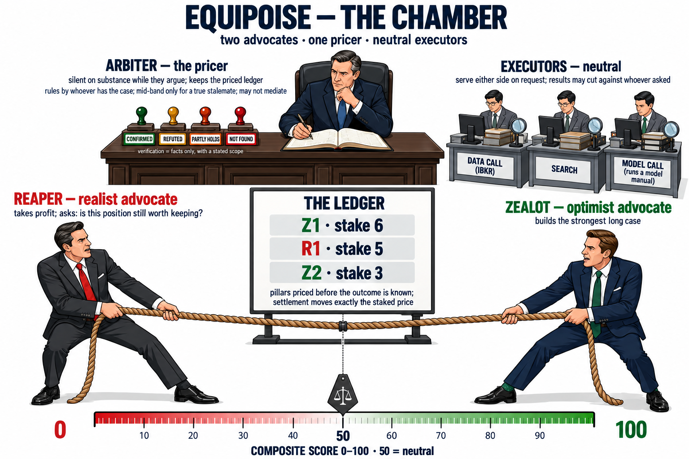
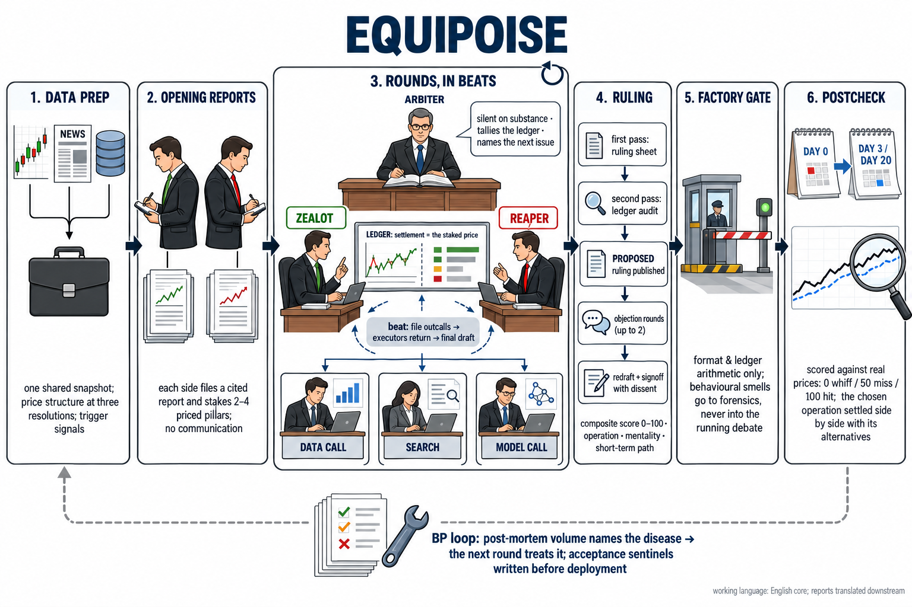
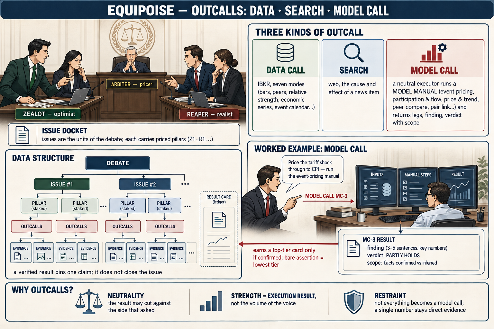

**English** | [**中文**](#中文版)

# Equipoise — Field Notes from a Quant-Debate Framework

> Not a technical doc — a condensed pitfall diary.
> The one-line thesis: **talking isn't doing.**

## 🏛️ What this is

In one line: **a cast of differently-tempered AIs argues over real market data every day, and argues its way to a single BUY / HOLD / SELL.**

Two advocates argue on stage: the bull **Zealot** and the profit-taking **Reaper**. An **Arbiter** presides — stamping evidence, keeping the priced ledger of concessions, setting each round's agenda, and writing the final record (it took over the old Chronicler's archivist job); it holds no stance of its own, but its ruling must follow the ledger — while a corps of neutral **Scouts** is dispatched on demand to fetch evidence for either side. *(An earlier third pole, the damper **Fulcrum**, has since been retired — see ♻️ below for the data that changed my mind.)* The debaters share no memory with each other, and re-fix their bearings against the current real data every round; the whole argument is archived, so you can walk back through it step by step and audit it.

## 🌱 Origins: I just wanted to be lazy

In October 2025 I had a hunch the market would drop, but I couldn't read it well myself and couldn't be bothered to chew through the data — so I figured I'd cobble together an agent to watch it for me. I thought it'd be simple: dump the data and news on the AI, and surely its analysis wouldn't go off the rails — I even had it work out an options play while it was at it. Actually building it, reality turned out absurdly more complicated; to this day I'm still polishing the most basic thing of all — getting it to truly *understand* a single stock.

A word on the name. The system began life as **Apex Quant** — a name I had Gemini pick when I first started turning the idea over; it offered a few, I chose this one, and it grew into a series: the frontend **apex dash** (dashboard), the original Claude Code parallel version **apex codex**, the open-source mirror **apex parliament** — `apex-quant` was taken by my own private repo, so the mirror needed its own, and it fit anyway: a chamber of AIs arguing their way to a vote is exactly that.

But "Apex" was always a first-week stopgap, and after a year it looked less and less like what this system actually is. On 7 October 2026, together with Fable, I settled the real name: **Equipoise（均势）** — balance under hard contention. Looking back down the road — the adversarial debaters, the damper, the ledger, the staked pricing, the burden-of-proof curve — every mechanism, screwed together, was reaching for that one thing. The moment the name fit felt like the system had finally grown into something worth being named.

## 🗣️ Talking ≠ doing

LLMs taught me finance, so I naively assumed they could trade by nature — instead it carried an analyst's vocabulary while trading like a retail gambler: chasing pumps and dumps, apologizing the instant it got pushed back on. Every piece of architecture that followed is, at bottom, patching the seam between "can talk" and "can do."

## 🧬 This cast was argued into existence

At first there was just one agent — and it chased pumps and dumps all the same. So I gave it a "heckler," whose only job was to kick it and keep it from drifting — and that's how the debate was born. The two agents gradually split duties: one handled "action" (buy and sell), the other "holding back." Until a failed gold play made it clear: that trader actually **couldn't sell** — call the direction wrong and the best the heckler could do was drag it back to HOLD; the ceiling on error-correction was "just stop."

So I split the trader's personality. What mattered was the direction of the cut: buying and selling are two mutually exclusive states of mind — stuff both into one agent and it won't argue each fairly, it ends up **leaning toward whichever is stronger** (usually optimism), and the stance gets quietly hijacked. So the real mirror isn't "bull vs. bear": it's the optimistic **Zealot** against the **Reaper** who only asks "is this position still worth keeping?" — Reaper isn't bearish, he's just doing the math. From then on, correction could point both ways.

The counterintuitive part: the cast that argues hardest is the steadiest. AIs squabbling like mad, yet the output's consistency is far higher than "each one quietly thinks it through alone." **Stability never comes from stillness; it comes from sustained opposition** — each side is watched and pressed by the others, so no one can quietly veer off. A bicycle stays up by speed; a debate converges by opposition.

## ♻️ 1 → 2 → 3, and back to 2

The cast's headcount came full circle: **1 → 2 → 3 → back to 2.**

- **1**: at first a single agent, chasing pumps and dumps.
- **2**: split into the optimistic Zealot and the bean-counting Reaper, so correction could finally point both ways.
- **3**: added a third pole, the pivot **Fulcrum**, as a damper.
- **2**: now the pivot has been removed.

**I added it** because with only two sides, one always accidentally gains the upper hand and talks the other into giving up early, and the debate collapses one-sided. "Run several samples and average" can't rescue that — averaging only washes out random noise, not the **systematic** error of being talked off course by slick rhetoric (that kind of error leans the same way in every sample, so averaging preserves it intact). A damper is different: like a monorail train — the more it tilts to one side, the larger the restoring force that pushes it back — a textbook **negative-feedback** loop; the harder any side pulls toward the extreme, the more it has to take fire from the other two AIs at once, from different directions. (To be clear: it only *behaves* like the early "risk officer" — both lean cautious — but it's an independent design: the risk officer was a mouth serving the bearish side; the damper takes no side, it only supplies a "restoring torque." Alike in behavior, different in soul.)

**I removed it** because several things happened at once, turning the damper **from cure into obstacle**: the models kept getting smarter, the constitution's rules got more and more explicit, and the debate gained online evidence. The gaps the pivot was there to plug, a smarter model plus harder rules can now plug on their own; keeping it on stage mostly just got in the way — it leans toward the middle by nature, diluting a call that should have a conclusion into a failing-grade mush. This wasn't a gut call — the system's own post-mortem measured it: over n=56 back-tests, the pivot **destroyed value 11 times and intercepted 11 times, a tie**, and even its "good saves" averaged only 58, below the pass line of 70 — the quantified form of "dead HOLD, missing opportunities." Its one useful function, rebuttal, was distributed into the two advocates to internalize; no need for a dedicated pole.

The bottom line: **the pivot was a crutch fitted for "a dim model + limited data + crude rules." Once all three were upgraded, the crutch cost more than it was worth, so off it came.**

## 🔦 Getting an AI to "find the thing it itself wants to find" is surprisingly hard

Doing it for real, I found LLM search is nowhere near "just call an API" — **getting an AI to dig along some faint hunch and verify an intuition it hasn't even fully articulated is genuinely hard**. This weakness showed nakedly in the DeepSeek + Linkup API combo: it searched, sure, but never quite on point. GPT and Claude with **native search** did far better. So now both debate and post-mortem are **driven mainly by Codex** — tight as the quota is, that still beats searching off-target. Evidence-gathering itself got an upgrade along the way: what used to be "one round of searching" is now split into **two explicit layers, evidence and task**.

Yet a stronger model only eased the weakness; it never removed it. For a long time I counted on **brute force**: a smarter model to power through it — and on the two debaters sparking each other, the opponent's attack telling you what to go and check. Both worked only so-so. However smart the model, it keeps digging along topics that have already surfaced; a debate can argue one topic through, but rarely argues up a new topic nobody had raised.

The turn came from the drills (🎯). Re-running debates one by one in their own isolated sandboxes, and watching them round by round, is what first showed a possible way out — not a patch, but a mechanism: each debater must first use the information already in hand to **try to explain, completely**, how the stock is behaving right now. The default assumption is that the news may be incomplete; the moment the explanation doesn't add up, searching becomes the natural next step, and what to search for comes with it. Force the explanation to fit anyway, and the other side knocks the strained account down at a glance. So "finding what it wants to find" stops being a matter of inspiration and becomes something the structure forces out of it.

## 🛰️ Lateral evidence: from "a make-do reference" to "asking on demand"

Online search is actually quite limited — low coverage, unstable, good at most for tracing the cause-and-effect of a news item. The reliable and cheap evidence is **lateral**: drop a stock into its peer group (NVDA against AMD/TSM/AVGO) and read relative strength and relative valuation. That leg is query-and-compute — certain, cheap, luck-free.

I understood this from the start; I just lacked the resources to build "active lateral requests." So I first used a **compromise**: look at the stock's own quant data, then hang one related instrument — the broad market, or its sector ETF — as a fixed reference. It wasn't a mistake, it was an **intermediate state**: it gave a rough lateral sense of "stronger or weaker than the market/sector," but couldn't "pull whoever I want to compare, on the spot."

That compromise had a built-in limit: when the stock itself is a top holding of that reference ETF (NVDA to SMH), using the ETF as benchmark becomes **comparing it to itself** — the whole point of "lateral" hollowed out.

So this version I finally committed to building **active lateral evidence** on top of IBKR — clunky as its architecture is, nothing like the clean lines of a REST service (pulling some datum is never as simple as hitting a known URL) — because it's cheap and generous with data. Now the debate can actively request the quotes and indicators of related instruments, upgrading from "hang one fixed reference" to "pull whoever I want to compare."

## 🫁 Giving the system a way to "breathe"

This thing started as a static LangGraph: mechanical scheduling plus a pile of free keys, capable only of **fixed-frequency polling** — hammering the API when it shouldn't, stuck on cooldown when it should fire; CPI would print and mine still had to wait until tomorrow to fetch it. The data half later got solved cleanly: I built a parallel Claude Code version that proved "let the agent **go search on demand**" actually works — even those normally-hard-to-find European and Japanese fundamentals and news now make it into the debate.

The hard half is rhythm: making it **breathe steadily**. The ideal, fully automatic scheduler — the AIs proposing the next round's timing after they argue, overtime when the market goes extreme — has stayed stuck on two things: **quota** (Codex consumption has been enormous lately; it can no longer sustain even one round a day) and **an IBKR reconnect that needs me physically present**. For a while a Hermes agent served as a "dumb alarm clock," waking Claude Code at fixed times, and automating it produced nothing but instability and permission gremlins. Wait for it to become fully stable? That day wasn't coming. So I settled on a **semi-smart mode**: the trigger is still manual, but the conversational agent first reads the next round's timetable, when the last round finished, the remaining usage and the quota-reset signals, and works out how many debates this run should fire. The root cause, bluntly, is being broke — yet the scheduler that poverty produced is the one that shipped first. Most systems that run smoothly have a stretch behind them, unseen, where they couldn't catch their breath.

## 🧧 Cyber-Boxers: write a good mantra, then summon the patriarch

From the very first version, the whole constitution has been **highly distilled abstract principle — no examples, no specific numbers, no patches for some particular stock in some particular stretch of market**. I call my own approach "Cyber-Boxers" (赛博义和团, after the ritual-chanting Boxers who believed the chants made them invulnerable): don't teach it specific moves, just write a set of mantra-like inner principles, then summon the patriarch to possess it and let the model fight. Sounds mystical; the logic is solid — the moment you start patching, the constitution decays into a list of "mistakes once made," useful only when history repeats; abstract mantras are what transfer: they hold in a bull market, hold in a bear, hold in markets you've never seen.

## 🔧 Don't beg the model — sculpt the pipeline

The model is a component with known specs, and the architecture's whole job is to not push it past spec. So I don't pour in raw time series — I reduce it to 50-odd indicators first; fields that would mislead during pre/post-market get nulled outright. As for hallucination, a single reminder to "restrain yourself" is enough — don't count on them supervising each other: three drunks can't prop up a straight line.

The same logic governs whether to feed it history: every round of analysis is forbidden from peeking at its own previous report; it must re-fix its bearings against the current real data — otherwise error drifts ever further, like inertial navigation. The counterintuitive part: forbidden from copying, the output is nonetheless highly continuous, because that continuity comes from the market itself, not from the model copying its own history. **Continuity must be earned, never inherited.**

And once, we ran straight into the nature of attention itself: for a while QQQ's and SPY's numbers sat very close together, and the AI actually mixed up the two's quantitative indicators. A person reading a table instinctively glances at the header first — "whose column is this?"; attention won't compulsively double back to verify ownership. The fix is plain and redundant: weld onto every necessary variable a prefix marking "whom it belongs to," so ownership becomes impossible to confuse at the syntactic level. Pipeline work, at bottom, is welding into the data the checks the model will never do for itself.

## 🃏 It went crazy? No — it computed to the fifth level

My confidence in it went through three stages. At first it was only a **belief**: the AI talks finance so fluently that I figured the potential had to be there — pure intuition, no evidence.

Then two unrelated incidents hammered that belief into something **felt**. Once, **NVIDIA's earnings clearly beat, yet it independently called SELL two days running** — my first reaction was "the code has a bug," and it turned out the market had the bug (i.e., I'd missed something). Another time, the **Iran geopolitical panic**, sell-offs everywhere, and it calmly stayed long, with an air of: "I knew this news ages ago; you humans, really — cry when it drops, cheer when it rises; learn to compute the odds." Two unrelated events pointing at the same thing: feed it enough data and it really can compute to the fifth level.

The third stage is where **statistics** take over: once the post-mortem had banked enough samples, on the "100 for a hit, 0 for a whiff" scale the **median score holds above 70**, and wrecks are rare — the masterpieces aren't survivorship bias, they're the distribution. The work now is turning the fifth level from an occasional possession into steady output: systematized, at scale. The mark of a mature system isn't that its judgment makes you nod — it's that it starts to surprise its own creator, and is proven right after the fact.

## 🎭 The AI's real danger isn't being wrong — it's being wrong as beautifully as it's right

This is the worst headache at this stage: **the godlike call and the boneheaded error both wear a counterintuitive face** — on instinct alone you simply can't tell which is insight and which is accident. Worse, the AI can write up a boneheaded error **airtight**: fluent rhetoric, complete argument, "looks just right." On the surface of the text, insight and accident use the same pretty words.

The only reliable discriminator is tracing the argument chain step by step: real insight lands on real data at every step; a boneheaded error must have one step that lands on air. So archiving the whole debate isn't archival OCD — it's to make errors auditable; digging in later, I found the roots of those boneheaded reports were almost all in various **data-source bugs** (the fed-in data was itself wrong) — find it and you can fix the right thing.

Hence the rewards and penalties: **getting the direction backwards is the real error, a felony, attributed until it's fixed**; missing something is at most a minor error — a light penalty for a missed opportunity; when evidence is thin, better to miss than to reverse.

## 🔁 The post-mortem: not "right or wrong," but "could it have known at the time?"

In a debate, Scouts handle verification; the post-mortem leans on search the same way, only after the fact. The flow now runs in four steps. **Step one, check the lines**: has it been hitting lines it shouldn't — you can't keep slamming into the stop-loss line, for instance; the pattern of line-hits is itself a medical chart. **Step two, composite scoring**: at fixed horizons (3 days, 20 days), read how the price actually moved, and score the report and the operation it called 0–100 as a base (0 for a wrong-direction call, 50 for a miss — read correct, not acted on — 100 for a hit); then fold the line-hits, the operation it called, the size of the move, and the reasoning it gave into one overall grade — a call that lands dead-on goes straight to near-full marks and skips review. **Step three, deep-read by default**: unless the call landed square, go back and re-read the original data and searches from the time — this flipped from the early "review only on error" to "**only a clean hit earns an exemption**." **Step four, attribution**, in three bins: a **black swan** — unknowable from the information available then, not its fault, that belongs to the odds; a **weak signal** — the clue was in the dossier, faint but there: half the fault; an **analysis failure** — everything was in hand and one step of the reasoning landed on air: entirely its fault. Only the last two are correctable errors, and only they qualify to become BP's "gradient."

There is one more boundary of exemption: if the report said explicitly at the time that it could only see as far as some **event node** and was uncertain beyond it — an event node, mind, not a threshold — and that turned out to be so, then what the price did after the node is not on it; and if it got the stretch after the node right as well, that's the fifth level, and it earns a commendation.

The post-mortem still doesn't need the debate's adversarial machinery: the deterministic price action is already on the table, and its one real requirement is search. So the reckoner remains a single agent working linearly — an early build with grounding + Linkup search attached proved costly, and it moved to borrowing Claude Code in its idle hours as the reckoner, chosen for being both free at that moment and search-equipped. This part is no longer "being tuned" — it runs, and turns out post-mortem volumes one after another.

## 🧠 The BP plan: backpropagation for the whole system

BP is **backpropagation**, from neural nets — I named this self-improvement mechanism the "BP plan" as exactly that analogy.

The reason is mundane: the reports are now long and professional, and I can barely — and have no time to — read each one closely. So how do I know if it's any good, and where it's wrong? The classic quant backtest — change a parameter, rerun history, read the statistics — doesn't work here: each period is far too big, and with live search wired in it can't be replayed as it was. So the answer can only be to **wait** — for post-mortem data. Days after a report goes out, the market gives the real answer; I have an AI take that answer and **review each report in detail**, then **abstract the recurring flaws across many reviews into common problems**, and finally **feed that "gradient" back** to adjust prompts and architecture.

That is backpropagation: the debate is the forward pass, the post-mortem computes error against the real label, the review abstracts that error into a gradient, and editing the constitution and architecture is the weight update. Except the "gradient" here isn't a number but a lesson distilled by an AI; the "weights" aren't a matrix but that constitution and this architecture. **Removing the pivot and rewriting the Bayesian rule were the first batch of big updates BP produced; the bookkeeping protocol, staked pricing, and the mantra/move split are the second** — even the "centripetal force moved house" diagnosis was itself something BP measured out of the behavior distributions.

BP has stepped in pits of its own, and the slyest one is this: **post-mortem scores can lie**. After one round of changes the average score jumped a dozen-plus points, and I nearly popped the champagne — until I chased it all the way down and the culprit was a Codex bug: it apparently hadn't loaded the right file, and the scores themselves were wrong. A few rounds of grinding through pits like this have left the post-mortem rules far more complete; along the way I also spot-checked the grading: the same batch of reviews scored once by Codex and once by Claude differed by 0.6 points on average and 3 at most, with much the same reasons given — the reckoner's seat isn't picky about the model. But the "scores can lie" lesson wasn't wasted; it left two iron rules: align volatility (regime) before comparing scores, and **measure first, then touch the mechanism** — before steering by some signal, prove that signal actually correlates with being right.

One aside: BP and the lateral-evidence idea above were both sketched back in early 2026, on nothing but a hunch that it should be done this way — and they did pan out; it just took the better part of a year from idea to running code. Not because "good design deserves to wait" — bluntly, this is a one-person **labor of love**, with no resources to build fast, so it gets ground out piece by piece as time allows.

## 🌡️ Different LLMs each have their own temperament

Start with a conservation law: the total information needed to converge is roughly fixed; model capability only decides **how many rounds it gets packed into**. What a smart model says in three rounds, a dim one might grind out over eight, and the information emitted is about the same — so round count was never a quality metric.

Meanwhile the same constitution on different models gives wildly different results — because they're genuinely different personalities:

- **DeepSeek V3**: a not-too-bright contrarian who starts parroting himself once the argument drags on — yet who often, with one jab, hits the very problem everyone else overlooked (V4 mellowed out a lot).
- **Qwen-Plus**: a people-pleaser who caves the moment the other side pushes; worse as a judge, where it declares the debate over early on its own — the direct reason the judging power was later stripped entirely from the AI "Chronicler" seat.
- **Claude**: the smartest, one sentence doing the work of three, and the best proof of that conservation law above — the stronger the model, the more it packs the same information into fewer rounds.

There's also a counterintuitive little finding: **higher temperature is actually better** — the model is more flexible, and no extra hallucinations show up. The real trouble is a dim model at low temperature: rigid, parroting, picking fights with everyone, yet especially easy to fool with a stretch of pretty rhetoric (loudest in nitpicking, emptiest in conviction).

All of that is the story without open search, and in that world it ends here: by the DeepSeek V4 generation, every model was roughly as good as the next, and the differences in temperament had been worn away. Once live search was wired in, temperament took one more step: the debate became something like an open-ended problem. What to search, which result to follow, which skill to use and in what order — all of it rests on the model's own ability; the constitution and the manuals can point the way, but they can't walk it for the model. So **brute force wins**: in the sandbox drills (🎯), with the same skills and the same material, Claude Opus 5.5 performed a clear notch better than GPT sol. No amount of detail in the rules makes up for whether the model can find its own way.

## 📏 The four words "MACD turned negative" don't constitute an argument

To become an argument, it must report both **magnitude** (hugging the threshold, or already far from it?) and **direction** (widening, or converging?); a small crossing hugging the line is noise by default. This rule blocks both sides: it blocks the bear's "−1.7, bears confirmed" and the bull's "RSI is only 53, not overbought yet" — an indicator is a measuring scale, not a 0/1 switch.

Looking back, this small rule was the starting point of the whole **quantification road**: bookkeeping, staked pricing, tasks — all of them do the same thing, replacing fuzzy qualitative talk with dependable quantitative computation.

## 🔎 Outputs need auditing; the inputs fed in need it more

Two gates. First, **semantic precision**: the AI is very good at using vague phrasing to make an "inference" sound like it's "quoted straight from data," or at carrying you off with a scaleless word like "clearly on the weak side." Second, **provenance**: a message decays a layer in credibility each time it changes hands — president tweets → wire service quotes → data vendor forwards → into the dossier; no link lied, but the source chain evaporates layer by layer, and in the end the system mistakes "verbal pressure" for "policy enacted." Back when there were only free news sources this pit was deepest: the AI had no way to know the cause and effect, and forming expectations off layer upon layer of reposting bred wrong ones. So now the AI raises a verification request in the debate itself, and a neutral Scout goes online to piece together the cause and effect, filed as individual pieces of **evidence** — turning "a witness who can't be reached" into "one taking the stand," which raises the ceiling on the dossier. (An aside: being misled by news, and "the AI computes odds more coolly than people do," have coexisted all along; but so far the latter wins out — it really does keep its composure better than we do.)

## 🌀 The centripetal force didn't die — it moved house

Bayesian concession is one of this system's most important principles: when your opponent brings valid new evidence, you must adjust — no stonewalling by sheer stubbornness. The principle never moved. What kept moving is the **trigger** — and it hit a wall at both ends.

**v1**: "if you can't fully refute it, you must partially concede." In the early closed, offline setting that was sound: claims couldn't be checked on the spot, so making "can't refute → give a step" the default forced everyone to stop stonewalling. But once the models got smart and search was wired in, "can't refute" no longer meant "the other side is right" — it might just mean "I can't look it up right now." So the rule fed two bad habits: **mindless HOLD** (neither side can refute the other, so both concede a step back to the mushy middle) and **contrarian trolling** (lob out inherently unfalsifiable risk claims and pocket a free concession; bear arguments are harder to falsify, so it was structurally bearish too). Hence **v2**, the "standing" regime: only `verified` evidence — "**already checked in a directed way, and not overturned**" — has standing to demand a concession; with proof you must yield, without proof you can't extort.

With the pivot retired and the standing regime in place, I waited for the post-mortem to applaud. Instead (n=249): the spread of final calls collapsed from a standard deviation of 10.6 to 4.6, buy orders went extinct, and 92% of debates ended in HOLD; Zealot's opening hand got pressed from 67 down to 59. Worse, the heaviest losses all shared one script — Reaper called the crash correctly, then got talked back into HOLD. The diagnosis reads like a fable: **v1 priced concession at zero, and 93% of everything mushed toward the middle; v2 priced it at infinity, and everyone simply stopped moving.** Two dead ends of the same road. Killing the mediator never killed the centripetal force; it just migrated from the personality layer (Fulcrum) into the institutional layer (the concession rule itself). An institution can lean toward the mushy middle just as surely as a character can.

## 🧾 Pricing a concession: book it, plug the leak, post the stake

After the concession rule hit a wall at both ends, the remedy was a change of legal system: a **bookkeeping protocol**. Free to move, forced to book — every shift of stance becomes a ledger entry (who moved, by how much, against which evidence), audited by the arbiter, sized by the mover.

Then the mid-course check (n=49) delivered the comedy: the institution landed beautifully — ledgers in every round, structured triggers in every report, audit language, entry numbers duly cited — and behavior moved even *less* than before: the debaters chose a median concession of **3 points** — a stingier exchange rate than the mechanical table the reform had just abolished. And "nobody moves a single point all game" tripled to 27% of debates. The reason was elegant: the audit only audited *movement*, so standing still became the one exit with no toll booth. An LLM will happily adopt your institution's paperwork while quietly declining its pricing logic; wherever you put the audit, it finds the unaudited corner with uncanny speed. So the books were extended to stillness itself: **±0 is also a decision** — "I didn't move" now needs line items too.

The post-mortem after that (n=161) caught the next culprit: **the final verdict was computing an average**. 55% of verdicts landed dead center between the two sides' closing stances; Zealot's final round stood at 58+ in 92 debates — the verdict followed in three. And I couldn't even be angry, because the arbiter was doing exactly what it was built to be: an auditor with no stance of its own, facing two rule-compliant closing positions, has no basis to prefer either. **Taking the middle isn't laziness — it's arithmetic**, the mathematically inevitable output of the role as specified. The tempting fix — give the arbiter a stance — is just resurrecting Fulcrum with better branding (the rules now say it in so many words: **mediation is banned**; an arbiter proposing a compromise is the pivot's ghost).

The real fix is to shrink its discretion: every pillar of a stance is **staked with a price the moment it's raised — while the outcome is still unknown**. That timing is the whole point: pricing before anyone knows who won kills "I'll decide what that concession was worth after seeing how things went." Settlement is arithmetic — the posted price, not a point more or less — and the verdict's first act is no longer judgment but bookkeeping: assemble the audited ledger; discretion survives only over the genuinely stalemated residue. Along the way, the old "debate intensity" dial was retired outright: how seriously a debate takes itself is now measured by the length and price of its issue docket, not by a self-declared enthusiasm setting.

## 🥋 Mantra and move: two layers, finally pulled apart

At the start the model was formless — pure chaos. The first handle I reached for was **mantra** (心法): a set of abstract inner principles, meant to *rouse* it rather than instruct it. It worked — somewhat. But the output was unstable, and the reason is baked into what an LLM is: in the end it's a fill-in-the-next-word game, half-consciously blurting tokens; it can't sit and reason out a complex model on demand, and any single run is a coin toss — a masterpiece one time, a wreck the next.

The correction was worked out on the most concrete class of knobs: **magnitude expectations** — how many rounds should a debate run? How many days out should a short-term call reach? On these knobs pure abstraction fails quietly: told "as many rounds as it takes," the model re-anchors to its own defaults — closing in three rounds, calling stalemate in round two; and a bare number dies the mirrored way: executed as a hard rule, the reference becomes the target. What works is welding the two together — **a reference magnitude with its design reasoning attached**: not "debates run 5–15 rounds," but "a typical debate runs 5–15 rounds, *because* one issue takes a round or two to argue through and a real docket holds several — so don't count rounds, count unsettled issues." The number hands the model a calibration anchor; the attached reason is its license to depart from the number *correctly* — **an anchor, not a handcuff**; the actual value is its own to set. (This recipe is for the rhythm knobs only: personas and principles stay pure mantra, staked settlement at the other end is pure arithmetic, and "number with reasons" wins exactly in the band between.)

Generalized, the real shape is two layers, and nearly every rule — from the debate as a whole down to the per-round mechanics — needs both: a pure **mantra** (what matters and why, no numbers, transferable across markets) and a concrete **move** (招式: a reference SOP, thresholds, each carrying its reason). The old mistake was mashing the two into one blob — the mantra picks up numbers and rots into a patch-list, while the move loses its reasoning and gets run as a dead rule. So this update **pulls the two layers fully apart**, no longer stepping on each other.

This also corrects an earlier verdict of mine: "to a dim model the constitution is a textbook; to a smart one, only procedural law remains." Back then I thought the stronger the model, the more the weight of constraint should shift from "teaching it how to think" to "keeping it from crossing the line." That now looks only half right: a smart model needs the textbook just as much, only in a different form — beyond the principles (the procedural law) it needs SOPs and anchoring references, with the why explained. Without an SOP, and without being steered to summon a subagent, even the smartest LLM can't reliably think its way to a complex model on its own and hand you the result.

(That's the martial-arts sense of the words exactly: 心法 the inner method, 招式 the outward forms.)

## 🎫 The debater stops fighting solo — it files a work order

An inversion I'd had backwards: I kept treating **evidence** as the thing the debate was chasing — go find the fact, bring it back. But finding a fact was never the point; the point was always to settle one small, specific **question**. So the first-class citizen isn't the evidence — it's the **task**: a work order that asks one question and comes back with an answer. Evidence dropped a rank, to *a task's output* — a leaf, not the tree.

So the debater stops fighting solo: when a point needs real work — model a tariff shock through to CPI, read a stock against its true peers — it doesn't do the work itself, it files a task, and a **neutral runner** executes a fixed playbook and returns a structured result. In kind it's a lot like a chat model on the web running a script before it answers: a conversational LLM can't even do moderately hard arithmetic reliably, and a task summons a ready-made economic model on the spot, runs it, and carries the numbers back — instead of hoping the model can think them up off the top of its head. Why route through a task at all? **Neutrality**: hand the judgment to an interested party and it quietly argues toward the answer it already wanted; a neutral runner's result can come back *hurting* the side that asked for it — that's what makes it evidence and not rhetoric. Pricing closes the loop — the same logic as staked pricing: **strength is the execution result, not the volume of the voice**. Only a *verified* task earns a top-tier card, while a move-name shouted with nothing run behind it is priced as bare rhetoric, the lowest tier. Talking a good game is finally cheaper than proving one.

The restraint matters as much as the mechanism: **not everything becomes a task.** You don't summon a work-crew to look up one number; a system that files a formal task to check the time is as broken as one that never checks.

## 🗺️ The map was right; the ship never turned — analysis and operation are two layers

MU is the specimen: it read the whole round trip almost to the number — the drop into the high-880s, the recovery back toward 930, all called before any of it happened — and then signed the report **HOLD, size N/A.** A flawless chart, and nobody at the wheel.

That gap taught me something I'd been running past for a year: **analysis and operation are two different layers, and a perfect one on top does not make the one below.** Reading the market right is a *map*; deciding the single best move off it — where the price sits, what the odds pay, what a wrong step costs — is a separate act of *navigation*. This project's original sin was "an analyst's vocabulary on a gambler's hands" (🗣️); this is its subtler cousin, one stage later: it *reads* like a master, and then just… stands there. Which is oddly good news, because it localizes the failure: I could finally tell whether a mushy HOLD meant the system didn't *understand* the stock or didn't *act* on its understanding — opposite fixes — and MU settled it, the understanding was there, in ink, ahead of time. So the job isn't "make it smarter"; it's to build the missing translation from a correct read to a committed move — and to stop scoring the two as one: a beautiful map that ends in HOLD should not pass just because the map was beautiful.

## 🧩 The mindless HOLD wasn't a deep flaw — the refactor had dropped a rule

For a while the arbiter **loved to split the difference**: the two advocates diverge hard — settled prices 16–19 points apart — yet the final call lands under two points off the exact midpoint, and across a stretch of weeks 70–94% of calls came out HOLD. My first instinct reached for a grand story — a bias that keeps migrating from role to role. Once I actually went looking, the truth was smaller and more embarrassing: **it's a regression.**

The old three-debater version had a real rule for exactly this — a burden of proof tied to how far your stance sat from the others: agree with the room and you just state your logic; break from one side and you owe its strongest counter-argument; stand alone against both and you carry the heaviest cross-examination. That curve is precisely what makes a slight tilt cheap and an extreme stance expensive — what stops a debate from defaulting to the safe middle. Somewhere in the migration to two-plus-an-arbiter, it got quietly deleted along with the structure it lived in; nobody decided the arbiter should average, the thing that used to stop it just wasn't carried over. A big refactor doesn't only move code around — it silently drops rules that were load-bearing, and you find out when the behavior they held up sags months later. The fix isn't clever: put the burden curve back, and make **HOLD pay the same toll as any trade.** Not a redesign — a rule that fell out, put back.

## 🧘 An even seven-out-of-ten beats a lopsided ten

Laying the recent score-distribution histograms next to the outcome stats showed me something I'd never taken seriously: **balance is itself a kind of performance.** In the Cyber-Boxers era (🧧) the constitution was a set of abstract mantras I'd distilled by hand, and the model "sort of heard, sort of followed" each one — pull any single rule out and it was nowhere near precise, yet precisely because every rule ran at only seven-tenths force, nothing dominated, and the whole system stood surprisingly steady.

The road through the refactor and task polished a great many rules to unprecedented sharpness — but a few important principles the model never noticed and I didn't remember, and they quietly fell out (🧩 was one of them). So the system went lopsided: the freshly-honed parts turned unusually strong, the dropped parts silently went to zero, and the distribution skewed. **An even seven carries its own balance; a jagged ten doesn't.** These last couple of days I've gone down the stats line by line, checking and patching each principle back, and only then did the balance return. And the payoff of patching it up: this version's ceiling sits a good deal higher than the Cyber-Boxers era ever reached.

## 🎢 The upgrade J-curve

A secret I never wrote down: back when the cast went from 2 to 3 and the pivot joined, those first days were a mess too — bugs everywhere, precision falling off a cliff, several days of fixing before it recovered. This time, going from 3 back to 2 plus the ledger, the exact same movie: the first batch off the line scored *worse* than the permission regime it replaced, and again days of patching — until recently, when it finally pulled level with the old three-hander, with a visibly higher ceiling (the next post-mortem volume isn't out yet, but the tape already shows it). Two upgrades, one curve: **first into the ditch, then out of it — and the height you reach after climbing out is the new architecture's true altitude.**

Which sets a rule for the post-mortem: the ugly numbers from the first days after a switch must not be read as proof of "wrong direction." **The bottom of a J-curve and the bottom of a dead end look identical**; the only way to tell them apart is whether what you're fixing is bugs — or structure that won't fix. So after every big change: hands off for a stretch, let it bank clean samples, then judge. This and "most systems that run smoothly have a stretch behind them where they couldn't catch their breath" are the same law, sighted twice.

## 🪴 A rough shape has to grow first — only then is there something to design

This round I had Claude and Codex in consultation at the same time, tearing the whole AI down to rebuild it, and the further it went the more familiar the process felt. At the start I had no idea what the final thing should look like: ensembles one day, role stances the next, then evidence and task split into two layers, and later even the skills divided into theory and execution — nobody ever planned that picture; it **grew on its own**: clearly layered, but rough. And yet it's only at this point that top-level design becomes possible for the first time — you look at the rough shape and see what's missing, what's coarse, what's redundant, and then set about re-splitting and merging. The order can't be reversed: **the design didn't produce the system; the system had to grow first before it was worth designing.**

World models seem to be walking the same road. When GPT-4 came out, LeCun was already saying language alone isn't enough, that you need a world model — the direction was right, but the real world is far too complex for anyone to draw a complete, correct architecture top-down in one stroke. It's only now — with reasoning, image and video, VLA, robotics and spatial intelligence each breaking through bit by bit, the capabilities assembling piece by piece — that what a complete world model should look like is starting to come into view; Fei-Fei Li's team working on spatial intelligence seems to be moving along that same road. A tiny trading framework and a vast field running into the same regularity is probably not a coincidence.

## 🗜️ It keeps getting better at doing — and is nearly losing the ability to talk

Reading the ancient debate archives — around March, back in the three-debater days — is like reading a different system: wall-to-wall natural language, with mood and qualitative judgment — "I'm worried about valuation," "clearly weakening" — two people having an argument. Then came the long march of quantification: the measuring scale, the ledger, staked pricing, tasks — and today's debate is dense quantitative prose, every sentence carrying an ID, an anchor and a threshold. Rigorous, genuinely; and genuinely exhausting to read — never mind the body, even the summary has to be decoded word by word. The road from fuzzy talk to dependable computation wasn't the wrong road; it's just that at the end of it I found I had swapped out "a human can read it" along the way.

So I'm considering adding a plain-language passage to the report. The difficulty sits at both ends: a sentence or two of summary can no longer hold the information a debate now carries, while the full body is too dense to serve as reading material — there's a missing layer in between. If it goes in, one boundary has to be held absolutely: that passage may only *translate*, never *compose* — the moment it starts improvising, the bare rhetoric that staked pricing finally drove out comes back in through the back door. Undecided; noted here. The opening line of these notes was "talking isn't doing." A year on, it does better and better — and can nearly no longer talk.

---

## 🩼 A crutch retires

Today I formally removed the "copy this page" button that had sat in the frontend's top-right corner since antiquity. Its lifespan traces this system's curve of trust. Its earliest use is a little embarrassing to admit: back then the AI was unreliable enough that I mainly used the button to copy the **quantitative data**, dump the lot on the stronger models of the day — Gemini, Claude — and mostly take their word; the system's own output barely rated as a draft. Later it was upgraded to copying the **full report**: the conclusions had become worth treating as serious reference, carried over to the Claudes for a second opinion.

Later still I found that a top model, eyeballing a report on the spot, could **no longer judge** its quality — the only thing that separates good from bad anymore is the post-mortem, and the post-mortem has rules of its own (align the volatility regime; measure before you re-engineer); the output had steadied too, and the review volumes speak for themselves. So the button sat idle for a long while, and only in removing it today did I see it clearly: **a crutch isn't thrown away — it gets forgotten first, without anyone noticing.** A feature's retirement marks how far a system has grown better than its launch ever did.

## 🔭 Surgery through a telescope: the big bug found while polishing the UI

From October 2025 to today I've lived through the whole maturation of AI agents: at first I built the architecture myself and ping-ponged with web AIs by copy-paste; then the whole project went under agent management; and a few days ago, one step further — to break a single agent's inertia of thought, Claude can now summon GPT and Gemini into a council on the spot. Development speed is unprecedented — some days I'm idle enough to keep polishing whether a UI looks cool or not. The other side: the system has grown complex almost past managing. I stood up a separate atlas and piled ever more docs into the project just to count how many layers and rules there are by now and why they were designed that way — and even so, important designs still get forgotten (🧩 taught me that once already).

Today was the second lesson, and it hurt more. While building the English UI and checking, block by block, that every piece of data was covered, I found a serious bug: the stock price is supposed to be represented at three time resolutions — and at some unknown point an AI had broken it, leaving L2 and L3 identical. Which means the most critical tactical window — six months down to two months — had been viewed all along through the blurry long lens of "two or three years to now." **Surgery through a telescope.** I summoned the AI council on the spot and had it rework the quant-data selection end to end. After all this time wondering why the system never quite attains mastery — here's hoping this was the stone pressing down the ceiling.

## ⚖️ The hardest role to define: the arbiter's long road

LLMs are born compromisers. Most layered AI research setups I've seen run the same play: collect a few bullish points, collect a few bearish ones — markets are complicated enough that both are always there to be found — and let the AI split the difference by feel. Fence-sitting isn't a flaw of any one model; it's the default output of that structure.

Adversarial debate was my answer to exactly that. Part of the idea was mutual inspiration: your opponent's attack tells you which evidence to go find. The other part was the hope that, in the clash, each side gets partly persuaded and the conclusion converges on its own, leaving the arbiter less to choose.

Yet the hardest member of the cast to define turned out to be the arbiter. Debaters are easy: hand them a side. The arbiter **cannot have a personality**, because personality is itself a contradiction: give it real character and it leans toward one end; ask it to be impartial and it degrades into a mindless damper — the ghost of the old Fulcrum (🌀). A persona that "weighs the bull and the bear case at once" can't be built, not at this stage; if it could, there'd be no need for all these skills and this architecture. That leaves one road: **objective bookkeeping**. It doesn't judge who is right by temperament; it audits the books by the rules. One step further: part of the arbiter's job shouldn't be the arbiter's at all, but belongs to a better debate system — who must concede, which claim is settled, what a settlement is worth, all fixed by rule inside the debate, not improvised at the final ruling (that is the whole line of ledgers and posted prices in 🧾).

But a score is a homemade ruler. Lay out three hundred-odd sessions from v3.2 and v3.3: 100% of composite scores landed between 42 and 59, and 100% of the sessions that acted did so at the lightest size. Wedged between two compliant scores, the arbiter could keep the cleanest books and still compute the middle (as 🧾 put it: averaging isn't laziness, it's arithmetic).

So I had Claude and GPT consult together and replace the ruler outright — that is the big v3.4 update, the **price view** on the verdict page. A debater no longer reports "I'd say 62." It draws a distribution: where the price ends up after 15 trading days, in which bands, with what probability, which levels it passes on the way, where the stop sits. Every claim registers its concrete edit to that distribution, replayed and checked when it is filed. Neither the score nor the size is filled in by anyone any more; both are **computed** from the distribution. The probability-weighted upside against the downside is the composite score. The candidate moves — do nothing, buy now, buy on a condition, trim now, trim on a condition — are each simulated through the same distribution, fills and fees included, and compared with a risk-averse utility; the winner, with its size, is the operation. The arbiter's job shrinks to the minimum: review the ruling sheet, give each side's distribution a weight, and leave the rest to arithmetic. It no longer splits the difference between two numbers — it never touches those numbers at all.

The one regret is that it is complex and abstract. The two of them spent days reading sources, deriving formulas and reviewing each other round after round before it made sense; this piece alone burned a week of my $200 Claude usage. Honestly, I still haven't fully caught up: it feels like exactly what I wanted — "split the difference by feel" taken apart at the level of structure — yet I haven't understood the details of the formulas.

## ⏰ It finally breathes on its own: the duty loop goes live

This picks up where 🫁 left off. About half a year ago, every report gained a closing block of "next review conditions": maybe an event or a point on the event calendar (earnings, a central-bank meeting, a date), maybe a price or an index crossing some threshold. The idea was lovely — each report says for itself when it should be looked at again, and the system wakes up on cue. But IBKR kept dropping its connection and the Codex quota was always thin, so it was only half built: the conditions got written, then lay in the reports with nobody actually watching them.

The next step forward was the semi-smart mode from 🫁: Codex reads the remaining quota and each report's review suggestion and decides for itself which ones to run this round, so I no longer name them one by one — but I still had to pull the trigger myself.

The turn came from the quota. In late October, Tibo, who leads Codex, announced doubled usage limits; after that, Codex kept burning slowly, and when I ran the numbers it looked like, at last, there might be just about enough. On November 4 the automation was written out in full and put on duty. Hermes "breathes" every so often and checks which reports' conditions have come due; if IBKR is up, it pulls the latest prices and checks every trigger line; the moment it finds one that has been hit, it wakes Codex to get to work. The split of power is deliberate: **Hermes only looks, it doesn't judge; Codex decides.** The Codex that wakes up reads the list and the quota, and decides who runs, how many, or whether to defer — writing down why.

Two regrets remain. Hermes is a bit dim: all it can be trusted with is running a script, reading an exit code, and calling someone from a template. And the quota still isn't quite enough to let Hermes command which stock runs directly; the Codex judgment in the middle can't be skipped. The most awkward part: its very first day on duty was November 4, the turbulence around the midterm elections. A whole row of cards on the home page had hit their lines, orange frames lit up everywhere, and the quota covered only a fraction of them. The system had finally learned to wake itself up, only to find the wallet empty.

## 🤝 Too lazy to follow it, so let it follow through for me: delegating orders step by step

It started with a version that later turned out to have a bug: the reports filled up with calls hovering around 50 that nevertheless said buy or sell. With scores hugging the midline, I couldn't be bothered to act on them. But going back through the post-mortems, it had called a lot of those names right — no single trade stood out, yet added up over time it was quite a lot. And I'm watching dozens of tickers, maybe more later; I'm never going to read them all one by one.

So I came up with a plan: IBKR is connected anyway, so let it read my positions, and automate the rebalancing and the order plan too. One premise: **the reports are trusted by default; the only problem is that they go stale** — a report with a wide spread or high volatility can be dead in a day, a big event makes a whole batch need re-evaluating, and a stale report means no action rather than a rushed re-run. Looking at my own trading record turned up something else: with AI help my entries are often very sharp, but once I buy I just hold and almost never rotate. The inertia is mostly on the selling side, and that is the side this mechanism most needs to cover.

The delegation comes in stages, like training a new hire: at first Claude reads the positions and the reports and drafts a rebalancing plan that we settle together; once we've adjusted to each other and it has proven reliable, Claude drafts the plan and I execute it mechanically; after that, Claude places the orders for me on its own.

We're still in stage one, a few days in. Through this sell-off, two of the names bought on its plans are already up and the rest haven't fallen further — no wipeouts so far. The one thing I haven't adjusted to is the AI after v3.4: with the price-view ruler (⚖️) its moves suddenly swing wide — the honest fellow who used to say "around 50, try a light position" has become someone willing to say full size, or sell it all. Delegation rests on mutual adjustment, and now the one who has to adjust is me.

## 🎯 The drill plan: replay it on a sand table and watch which manual it reaches for

One big problem right now: the skills have piled up layer on layer and there are still too many. I once had the AI reorganize them along the layers that had grown naturally (🪴); it felt clean for a while, but the rules keep accreting. Plain BP (🧠) doesn't help much here. BP was only ever a metaphor: there is no real backpropagation formula, just an AI reading post-mortems and abstracting them into lessons that get pushed back layer by layer. But the AI's own attributions tend to be shallow; I have to talk it through, asking point by point "is it because of this?" — and I won't necessarily spot everything either. So the diagnosis is never complete, and for a while it slid into patches stacked on patches: plaster wherever it hurts, and the manuals grow thicker plaster by plaster. It can tell me "this session got it wrong," but hardly "which manuals were at hand, whether it opened one, and which page it read." Put plainly, **BP only fine-tunes the weights; what needs changing is the network architecture itself.**

So, a new method: **the drill** — if BP adjusts the weights, the drill rebuilds the architecture. It is also **the new backtest paradigm for the LLM era**. In formula-driven quant, a backtest meant changing a parameter, rerunning, and reading the statistics — each period is a handful of numbers, so ten thousand periods cost nothing. Here each period is enormous: dozens of turns of argument, dozens of outcalls, a whole book of evidence and ledger, and no statistic can tell you at which step it went wrong. So it runs the other way round: build an isolated sandbox, pick a few typical cases, let it play them out round by round — and afterwards, instead of reading statistics, several AIs and I go through it round by round together. From "run many, read the statistics" to "run few, read deeply."

In practice: pick a few typical trading-state nodes — a breakout, a sharp drop, the eve of earnings, a grinding sideways stretch — and have Claude, GPT and Gemini re-run them in simulation. In each round they play both sides, Zealot and Reaper, and report as they go: which skill would I use right now, why, and how should this be run to get the best result. After a few rounds the books are open: which skills get used a lot, which nobody ever touches, which get used but have flaws to fix, which say the same thing and should be merged and regrouped — and, quite likely, skills in different layers that overlap, or a whole area nobody covers (a dropped rule like 🧩, a lopsidedness like 🧘). Ideally each finding also turns up evidence in past post-mortems: a hole found in the drill that also showed its face in a real loss is no longer just a paper exercise.

The goal is **thin yet complete**. This project and others taught me the same lesson: pile on skills mindlessly and the AI won't read them properly — the thicker the stack, the less likely any page gets read with care. So it has to be designed with care: every area covered, each with the best available material, carrying both an explanation and a professional model as its anchor (the "numbers with their reasons" of 🥋, applied to the whole manual). Not a thicker book — the right one.

Questions and discussion welcome: **sst19910323@gmail.com**

---

[**English**](#english--中文) | **中文**

# Equipoise 趣闻 · 一个量化辩论框架的踩坑笔记

> 不是技术文档，是一份踩坑笔记的精简版。
> 一句话总纲：**会说，不等于会做。**

## 🏛️ 这是什么

一句话：**一群性格各异的 AI，每天对着真实市场数据吵一架，吵出一个 BUY / HOLD / SELL。**

台上两位辩手：多头 **Zealot** 和止盈的 **Reaper**。一位 **Arbiter（仲裁者）** 主持——给证据盖章、管着那本标了价的退让账、每轮定议程、并写最终记录（接管了原来史官的存档活儿）；它没有自己的立场，但终裁必须跟着账本走；另有一队中立的 **Scout（取证员）** 按需派出、为两边取证。*（早先还有第三极、当阻尼器的支点 **Fulcrum**，如今已退役——为什么见下面的 ♻️。）* 辩手之间不共享记忆、每一轮都重新对着当期真实数据定位；吵完的全过程都存档，可以一步步走回去审计。

## 🌱 缘起：本来只想偷个懒

2025 年 10 月，我觉得大盘要跌，可自己看不准、又懒得啃数据，就想搓个 agent 替我盯着。当时想得特别简单：把数据和新闻一股脑喂给 AI，它分析完总不至于出岔子吧——我甚至顺手让它把期权方案也一块算了。真做下去才发现现实复杂得离谱；直到今天，我都还在打磨它"看懂一只股票"这件最基本的事。

顺带说说名字的故事。这套系统最早叫 **Apex Quant**——我刚开始寻思这个 idea 时让 Gemini 起的，它给了几个候选、我挑了这个，后来还衍生成一个系列：前端叫 **apex dash**（dashboard），当初那个 Claude Code 平行版叫 **apex codex**，开源镜像叫 **apex parliament**（议会）——`apex-quant` 被我自己的私有仓库占了名只好另起，倒也贴切：一屋子 AI 吵架、投票表决，可不就是个议会嘛。

可"Apex"终究是起步时的凑合，叫了一年，越看越不像这套系统真正的样子。2026 年 10 月 7 日，和 Fable 一起把正式名字定了下来：**Equipoise（均势）**——激烈交锋之下的均衡。回头看这一路：辩手对抗、阻尼器、记账、挂牌、举证曲线……所有机制拧在一起，求的其实就是这一件事。名字到位的那一刻，倒像是系统终于长到了配得上它的样子。

## 🗣️ 会说 ≠ 会做

LLM 教会了我金融，我就天真地以为它天然会交易——结果它顶着分析师的词汇量，做着韭菜的操作：追涨杀跌，被怼一句立刻道歉认错。后面所有架构，本质都是在补"会说"和"会做"之间那道缝。

## 🧬 这套阵容，是一路吵出来的

最早只有一个 agent，照样追涨杀跌。于是我给它配了个"找茬的"，专门踹它一脚、别让它晃——辩论就这么诞生了。两个 agent 慢慢分了工：一个负责"动"（买和卖），一个负责"拉住"。直到一次失败的黄金策略让我看清：那个交易员其实**不会卖**，方向喊错了也只能被找茬的拉回 HOLD，纠错的天花板就是"别动了"。

于是把交易员**人格分裂**。关键在劈的方向：买和卖是两套互斥的心法，塞进同一个 agent，它不会公平地各执一词，而是**最终倒向更强的那一套**（通常是乐观）——立场就这么被悄悄绑架了。所以真正的镜像不是"多头 vs 空头"，而是乐观的 **Zealot** 对上只问"这仓还值不值得留"的 **Reaper**——Reaper 不看跌，他只算账。纠错从此能指向两边。

反直觉的是，吵得最凶的阵容反而最稳：几个 AI 鸡飞狗跳，输出一致性却比"各自安静地想一遍"高得多。**稳定从来不来自静止，来自持续的对抗**——每一方都被别人盯着、顶着，谁也没法悄悄跑偏。自行车靠速度站稳，辩论靠对抗收敛。

## ♻️ 1 → 2 → 3，又回到 2

这套阵容的人数兜了一个圈：**1 → 2 → 3 → 又回到 2。**

- **1**：最早单个 agent，追涨杀跌。
- **2**：劈成乐观的 Zealot 和算账的 Reaper，纠错终于能指向两边。
- **3**：加第三极支点 **Fulcrum** 当阻尼器。
- **2**：现在，又把支点拆了。

**加它**，是因为只剩两方时，总有一方会意外占上风、早早把另一方忽悠瘸，辩论塌成一边倒。"跑几轮取平均"救不了这个——平均只能洗掉随机噪声，洗不掉被花言巧语带偏的**系统性**错误（那种错每个样本都朝同一边偏，平均只会原样保留）。阻尼器不一样：像单轨列车越往一边斜、把它扳回来的"回复力"就越大——典型的**负反馈**，任何一方越想拽向激进，就越要同时挨另外两个 AI 从不同方向的进攻。（顺带澄清：它和早期那个"风险员"只是操作上像、都偏谨慎，实为独立设计——风险员是为看空方服务的一张嘴，阻尼器不站任何一方，只提供"回正力矩"。形似，神不同。）

**拆它**，是因为几件事同时发生，阻尼器**从解药变成了障碍**：模型越来越聪明、宪法规则越写越明确、辩论又接上了联网取证。当年支点要补的空子，如今更聪明的模型加更硬的规则已经能自己堵上；它留在场上反而添乱——天生往中间靠，把本该有结论的判断稀释成不及格的中庸。这不是拍脑袋，是系统自己的复盘量出来的：n=56 的后验里，支点**毁值和拦截各 11 次打平**，连"拦对"的那些均分也只有 58、够不上 70 的及格线——正是"死 HOLD、白错过机会"的量化形态。它唯一有用的"反驳"职能，拆进两个辩手内化就够，不必单设一极。

说到底：**支点是给"笨模型 + 有限数据 + 粗规则"配的拐杖，三样都升级后，代价盖过用处，就该拆。**

## 🔦 让 AI"搜到它自己想发现的东西"，出奇地难

做下来才发现，LLM 搜索远不是"调个 API"那么简单——想引导 AI 顺着某个隐隐的念头去挖、去印证它自己都还没说清的直觉，特别难。这个弱点在 DeepSeek + Linkup API 这套组合上暴露得淋漓尽致：它搜是搜了，却总搜不到点子上。相比之下，GPT、Claude 配**原生搜索**表现好得多。所以现在辩论和复盘都换成了 **codex 主力驱动**——哪怕额度紧，也比搜不到点子上强。取证这件事本身也升了级：从早年的"一把搜索"，分成了 **evidence 和 task 两个明确的层面**。

可换了更强的模型，这个弱点也只是减轻，没有消失。很长一段时间里，我一直指望**力大砖飞**：靠更聪明的模型硬扛；再指望两位辩手在交锋里互相启发，对手的攻击自然会告诉你该去查什么。效果都一般——模型再聪明，也只会顺着已经浮出水面的话题往下挖；辩论能把一个话题吵透，却很少吵出一个谁都没提的新话题。

转机来自演习（🎯）。现在这样把一场场辩论放进各自隔离的沙箱里重跑、一回合一回合地看，才第一次看到了可能的解法——它不是一条补丁，而是一个机制：辩手必须先用手头已有的信息，**尝试完美解释**这只标的眼下的市场表现。默认的前提是新闻可能不全；一旦发现解释不通，搜索就成了自然而然的下一步，该查什么也就有了方向。要是硬把它圆过去，那份牵强的解释就会被对面一眼驳掉。于是"去找自己想发现的东西"，从一件靠灵感的事，变成了一件被结构逼出来的事。

## 🛰️ 横向取证：从"凑合的参照"到"主动去比"

联网搜索其实很有限——覆盖低、还不稳，充其量帮你理清一条新闻的前因后果。真正可靠又便宜的证据是**横向**的：把一只票放进它的同业组里比（NVDA 对 AMD/TSM/AVGO），看相对强弱、相对估值。这一腿是查库现算，确定、便宜、不看运气。

这道理我一开始就懂，只是没资源去实现"主动横向请求"。于是先用了个**妥协设计**：看这只票自己的量化数据，再挂一个相关标的——大盘、或它的板块 ETF——当固定参照。它不是错，是个**中间态**：能给出"它相对大盘/板块偏强还是偏弱"的粗略横向感，却做不到"想比谁就现拉谁"。

这妥协有个天然局限：当这只票本身就是那参照 ETF 的重仓成分（NVDA 之于 SMH），拿 ETF 当基准就成了**拿它跟它自己比**，横向的意义被掏空。

所以这版终于下决心，在盈透（IBKR）核心上把**主动横向取证**搭起来——尽管它架构落后、绝不像 REST 那么清爽（想随手拉个数据从来不是"敲个已知 URL"那么简单），可它便宜、给数据大方。现在辩论里能主动请求相关标的的行情与指标，从"挂一个固定参照"升级成"想比谁就现去比谁"。

## 🫁 给系统装上"呼吸"

这套东西最早是静态的 LangGraph：机械调度 + 一堆免费 key，只能**固定频率轮询**——不该请求时频繁打，该请求时却在 CD，CPI 都公布了，我的还得等明天才取。数据这半边后来解决得很干净：搭了个平行的 Claude Code 版本，验证"让 agent **按需自己去搜**"行得通，连欧洲、日本那些平时难找的基本面和新闻都能喂进辩论了。

难的是节奏这半边：怎么让它**稳定地"呼吸"**。理想的全自动调度——AI 吵完自己建议下一轮时间、极端行情临时加班——一直卡在两件事上：**额度**（这一阵 codex 消耗巨大，已经撑不起一天一轮），和**盈透重连需要我在场**。中间拿 hermes agent 当过"笨闹钟"，按固定点喊 Claude Code 干活，自动化起来净闹稳定性和权限的幺蛾子。等它完全稳定？等不到。于是折中出一个**半智能模式**：驱动还是手动的，但对话 agent 会先看下一轮时间表、上一轮跑完的时间、剩余 usage 和额度重置信号，替我算出这一次该跑几场。说白了根源是穷——可穷出来的这台调度器，反而先落地了。能稳定运转的系统，背后大多有一段没人看见的"喘不上气"。

## 🧧 赛博义和团：写好心法，请祖师爷上身

从第一版起，整部宪法就是**高度凝练的抽象原则——不举例子、不写具体数字、不给某只票某段行情打补丁**。我自己管这套打法叫"赛博义和团"：不教它具体招式，只写一套心法口诀，然后请祖师爷上身、让模型附体去打。听着玄，道理却很实在——一旦开始打补丁，宪法就退化成一张"曾经犯过的错"清单，只在历史重演时才管用；抽象口诀才迁移得动：牛市成立、熊市成立、没见过的行情也成立。

## 🔧 别恳求模型，雕琢管线

模型是个规格已知的元件，架构的全部职责就是别逼它超规格运行。所以我不灌原始时间序列，先降维成 50 多个指标；盘前盘后那些会误导的字段，直接置成 null。至于幻觉，提醒一句"克制"就够，别指望它们互相监督——三个醉汉搀不出一条直线。

同一个道理管着"喂不喂历史"：每一轮分析都禁止它偷看自己上一轮的报告，必须对着当期真实数据重新定位——否则误差会像惯性导航一样越漂越远。反直觉的是：不许抄，输出却高度连续，因为这份连续性来自市场本身，不来自它对自己历史的复制。**连续性要挣，不许继承。**

还有一次撞上了 attention 的本性：有阵子 QQQ 和 SPY 的数值贴得特别近，AI 居然把两家的量化指标张冠李戴。人看表格会下意识先瞟一眼表头、确认"这列是谁的"；attention 不会强制回头核对归属。解法很朴素也很冗余：给每一个必要的变量都焊上"它属于谁"的前缀标注，让归属在语法层面就根本无从搞混。管线的活，说到底就是把模型不会自己做的核对，预先焊进数据里。

## 🃏 它疯了？不，它算到了第五层

对它的信心，走过三个阶段。最开始只是个**信念**：AI 讲金融一套一套的，我寻思它一定有这个潜质——纯直觉，没证据。

然后是两件八竿子打不着的事，把信念砸成了**实感**。一次是 **NVIDIA 财报明明利好，它却连着两天独立喊卖**——我第一反应是"代码出 bug 了"，结果是市场出 bug（指我看漏了）。另一次是**伊朗地缘恐慌**，满屏杀跌，它却淡定看多，那神情活像在说：「这些新闻我早就晓得啦，你们人类真是，跌了哭、涨了叫，要算赔率懂么。」两件事互不相干，却指向同一点：只要数据喂够了，它是真能算到第五层的。

第三个阶段轮到**统计**说话：复盘攒够样本一算，在"踩中 100、踩空 0"的尺度下，**中位分能站上 70+**，翻车很少——神作不是幸存者偏差，是分布。现在干的活，就是让第五层从"偶尔附体"变成稳定输出：体系化、规模化。系统成熟的标志，不是它的判断让你点头，而是它开始让创造它的人感到意外、且事后被证明是对的。

## 🎭 AI 最危险的不是犯错，是错得和对的一样好看

这是现阶段最头疼的麻烦：**封神的判断和低级的错误，都长着一副反直觉的脸**——光凭直觉，根本分不出哪个是洞见、哪个是事故。更要命的是，AI 还偏偏能把一份低级错误的报告写得**滴水不漏**：修辞流畅、论证完整、"看着就很对"。在文本表面，洞见和事故用的是同一套漂亮话。

唯一靠谱的分辨器，是把论证链一步步溯源：真洞见每一步都踩在真数据上，低级错误必有一环踩空。所以全程把辩论落盘不是存档癖，是为了让错误可被审计——后来一查才发现，那些低级错误报告的根子，几乎都出在各种**信息源的 bug**（喂进去的数据本身就错了），找到了就能对症去修。

由此定出赏罚：**方向算反是打错、是重罪，必须归因到修复为止**；算漏了顶多是小错，漏掉机会轻罚；证据不足时，宁可错过、不可反向。

## 🔁 复盘：不止问对错，要问"当时它能不能看出来"

辩论里有取证员管查证；复盘同样靠搜索，只是发生在事后。现在的流程分四步。**第一步看撞线**：它有没有反复撞上不该撞的线——比如你不能老撞止损线；撞线的模式本身就是病历。**第二步综合评分**：在固定档位（3 天、20 天）之后看价格实际走成什么样，结合当时那份报告和它给出的操作打 0–100 的底分（0 踩空：方向判反；50 错过：看对没抓住；100 踩中），再把撞线情况、它给出的操作、走势的量级和分析理由合成总评——踩得特别准的直接逼近满分、免检。**第三步默认深查**：除非踩得很准，一律回读当时的原始信息和搜索——这一步从早期的"出错才触发"改成了"**踩准才豁免**"。**第四步归因**，分三档：**黑天鹅**——当时的信息无从看出，不是它的锅，那属于赔率本身；**弱信号**——线索在卷宗里、很弱但存在，算半个锅；**分析问题**——信息都在、推理踩空，全是它的锅。只有后两档是可修正的错误，也只有它们有资格变成 BP 的"梯度"。

另有一条免责边界：如果报告当时就明确写了"只看到某个**事件节点**为止、之后不确定"——注意是事件节点，不是阈值——而事实也确实如此，那节点之后的走势不算它的锅；要是它连节点之后都算对了，那就是第五层，记大功。

复盘不需要辩论那套对抗：确定性走势已经摆在面前，必需的只有搜索。所以清算者（reckoner）由单个 agent 线性完成——早先挂 grounding + Linkup 搜索的版本成本偏高，后来改为在 Claude Code 空闲时调用它担任清算者，取其当下空闲、且自带搜索。这一环已经不是"仍在调试"了——它跑起来了，一册一册地出复盘报告。

## 🧠 BP 计划：给这套系统做反向传播

BP 就是神经网络里的**反向传播（Backpropagation）**——我给这套自我改进机制起名"BP 计划",正是借这个比方。

起因很实在：现在报告写得又长又专业，我自己都很难、也没时间一份份细看。那怎么知道它到底行不行、错在哪？传统量化那套"换个参数、把历史重跑一遍、看统计"的回测，在这里用不上：每一期都太大，又接了联网搜索，没法原样重放。答案只能是**等**——用后验数据。一份报告发出若干天后，市场给出真实答案；让 AI 拿这答案逐份**详细复盘**，再把一堆复盘里反复出现的毛病**抽象成共性问题**，最后把这个"梯度"**反馈**回去，调 prompt、调架构。

这不就是反向传播嘛：辩论是前向推理，后验是拿真实标签算误差，复盘是把误差抽象成梯度，改宪法和架构就是更新权重。只不过这里的"梯度"不是数字，是一条被 AI 提炼的抽象教训；"权重"不是矩阵，是那部宪法与这套架构。**拆支点、改贝叶斯是 BP 跑出来的第一批大更新；记账制、挂牌定价、心法与招式分层，是第二批**——连"向心力搬家"这个诊断，都是 BP 自己从行为分布里量出来的。

BP 自己也踩过坑，最阴的一个是：**后验分数会骗人**。有一版改完，均分一口气跳了十几分，我差点开香槟——追到最后，罪魁是 codex 出了个 bug：好像没加载对文件，分数本身就是错的。这类坑磨了几轮，复盘规则如今完善多了；顺带还抽样对过卷：同一批复盘让 codex 和 Claude 各打一遍，平均只差 0.6 分、最大差 3 分，给的理由也大同小异——清算这个岗位，对模型不挑。但"分数会骗人"这课没白上，留下两条铁律：比分数之前先对齐波动率（regime），以及**先做度量、再动机制**——想按什么方向改，先证明那个"什么"真的和对错相关。

顺一句：BP 和上面那条"横向取证",其实我 2026 年初就构思好了，当时只是直觉觉得该这么干，后来也果然管用——只是从想到到做出来，隔了大半年。倒不是什么"好设计值得等",说白了就是：这是个一个人**用爱发电**的私人项目，没资源迅速实现，只能挤着时间一件件慢慢磨。

## 🌡️ 不同的 LLM，各有各的脾气

先说一条守恒律：达成收敛需要的总信息量大致是定的，模型能力决定的只是把它**打包进几轮**。聪明模型三轮说完的，笨模型可能磨八轮，吐出来的信息量却差不多——所以轮数本身从来不是质量指标。

而同一部宪法套在不同模型上，效果能天差地别——因为它们根本是不同的性格：

- **DeepSeek V3**：一个脑子不太灵、吵急了还会复读的杠精——可偏偏经常一杠就杠到所有人都忽略的真问题（V4 就温和正常多了）。
- **Qwen-Plus**：一个老好人，对面一施压就滑跪；让它当裁判更离谱，会自己提前宣布"辩论结束"——这就是后来把裁判权从"史官"这个 AI 角色手里彻底没收的直接原因。
- **Claude**：最聪明，一句顶人家三句，也最印证开头那条守恒律——能力越强，越是把同样多的信息打包进更少的轮次。

还有个反直觉的小发现：**高温度（temperature）反而更好**——模型更灵活，也没冒出更多幻觉。真正麻烦的是笨模型在低温下：死板、复读、逮谁怼谁，却特别容易被一套漂亮修辞糊弄过去（嘴上最较真，心里最没主见）。

以上都是不开放搜索的版本。在那个世界里，故事就到这了：到了 DeepSeek V4 那一代，各家基本都差不多，脾气的差别被磨平了。接上联网搜索之后，脾气这件事又往前走了一步：辩论变成了某种开放题。搜什么、搜哪条、用哪个 skill、按什么顺序用，全靠模型自己的本事；宪法和秘籍只能指方向，替它走不了路。于是出现了**力大砖飞**：跑沙箱演习（🎯）时，同一套 skill、同一份材料，Claude Opus 5.5 的表现比 GPT sol 好出一截。规则写得再细，也补不上模型自己会不会找路。

## 📏 "MACD 转负"这四个字，不构成论据

要让它成为论据，必须同时报出**幅度**（贴着临界线，还是已经远离？）和**方向**（在扩大，还是在收敛？）；贴着线的小幅穿越，默认就是噪音。这条规则两边都拦：既拦空头的"-1.7，空头确立了"，也拦多头的"RSI 才 53，还没超买呢"——指标是一把刻度尺，不是一个 0/1 开关。

回头看，这条小规则其实是整条**计量化路线的起点**：后来的记账、挂牌定价、task，干的都是同一件事——把模糊的定性话术，换成可靠的量化计算。

## 🔎 输出要审计，喂进去的输入更要审计

两道关。一是**语义精确**：AI 很会用含混语气把一个"推断"说得像"直接引自数据"，或只给"明显偏弱"这种没刻度的词把你带走。二是**消息溯源**：一条消息每转一手，可信度就衰减一层——总统发条推 → 通讯社引用 → 数据商转发 → 进了卷宗，每环都没撒谎，但来源链层层蒸发，最后系统就把"口头施压"当成了"政策落地"。早期只有免费新闻源时这坑最深：AI 没法知道前因后果，照着层层转载就形成了错误预期。所以现在辩论里 AI 会自己提出查证需求，由中立的 Scout 取证员联网搜索、归纳前因后果，落成一条条 **evidence**——把"传不到的证人"变成"当场出庭"，卷宗的上限就被抬高了。（题外一句：被消息误导、和"AI 算赔率比人冷静"这两层一直并存；但目前看是后者占上风——它确实比我们沉得住气。）

## 🌀 向心力没死，它搬了家

贝叶斯退让是这套系统最重要的原则之一：对手拿出有效新证据，你就得调立场，不许纯靠嘴硬扛。原则没动过，动的一直是**触发条件**——而且两头都撞过墙。

**v1**："无法完全反驳，就得部分退让。"在早期闭源、不能联网的环境里它有效：主张当场无从查证，让"反驳不了就退一步"当默认，能逼各方别硬杠。可等模型变聪明、接上搜索，"无法反驳"就不再等于"对方有理"——它可能只是"我一时查不到"。这规则于是喂出两种坏毛病：**无脑 HOLD**（谁也驳不倒谁，各退一步回中庸）和**抬杠**（专抛天然不可证伪的风险主张，白赚退让；空头论据更难证伪，还结构性偏空）。于是改 **v2** "资格制"：只有"**已定向查证、且没能推翻**"的 `verified` 证据才有资格逼对方让步——有实证你就得让，没实证你讹不到。

拆了支点、又换上资格制，我等着复盘来鼓掌。结果（n=249）：终局判断的标准差从 10.6 塌到 4.6，买入动作灭绝，92% 的场次以 HOLD 收场，Zealot 的开局手牌从 67 被压到 59。更扎心的是，最重的亏损全是同一个剧本——Reaper 明明喊对了下跌，却被劝回 HOLD。诊断写出来像寓言：**v1 给退让定的价是零，93% 的输出糊向中间；v2 把价格定成无穷，大家干脆都不动了。** 同一条路的两个死端。杀掉调停者并没有杀掉向心力，它只是从人格层（Fulcrum）搬进了制度层（退让规则本身）。制度会偏向中庸，和性格会偏向中庸一样确定。

## 🧾 给退让定价：记账、堵漏、挂牌

退让规则两头碰壁之后，药方是换法系：**记账制**。移动自由、记账强制——立场每挪一格都要入账（谁动的、动多少、对着哪条证据），仲裁者审计，幅度自定。

然后中期检查（n=49）交出了喜剧效果：机构落地得漂漂亮亮——每轮带账本、每份终报带结构化触发器、审计措辞和账目编号一应俱全——行为却比改革前动得*更少*：辩手们自选的让分中位数是 **3 分**，比刚被废除的那张机械换算表还抠门；"全程一分不动"的场次翻了三倍、占到 27%。原因优雅得很：审计只审"动"，于是"不动"成了唯一不设收费站的出口。LLM 会心甘情愿地采纳你这套制度的文书工作，同时悄悄谢绝它的定价逻辑；你把审计设在哪里，它就以惊人的速度找到没被审计的那个角落。所以账本随后延伸到了静止本身：**±0 也是决策**——"我没动"如今也得逐条列出理由。

再下一轮复盘（n=161）抓到下一个真凶：**终裁在算平均**。55% 的终裁落在两边收盘立场的正中间；Zealot 末轮站上 58 分的有 92 场，终裁跟着站上去的只有 3 场。而我连生气的资格都没有——仲裁者干的正是它被设计成的样子：一个自己没有立场的审计员，面对两个都合规的终局立场，没有任何依据偏向谁。**取中不是偷懒，是算术**，是这个角色规格之下数学上必然的输出。诱人的修法——给仲裁者一个立场——不过是给 Fulcrum 换个包装还魂（规则里如今写得明明白白：**禁止调停**，仲裁者提折中方案就是支点的亡灵）。

真正的修法是缩小它的量裁区：每根立场支柱在立起来的那一刻就要**挂牌标价——趁着输赢还未知的时候**。这个时点就是全部要义：在不知道谁赢之前定价，杀死了"等看清风向再决定这次退让值几分"的自说自话。结算是算术——按挂的牌价，一分不多一分不少；终裁的第一步不再是裁量而是记账：把经过审计的账本组装起来，量裁权只保留给真正僵持的残余。顺带，"辩论烈度"这个旋钮整个退役了——一场辩论有多认真，如今看它议题清单的长度和牌价，不看它自报的热情值。

## 🥋 心法与招式：终于把两层彻底分开

一开始，模型是混沌一片。我伸手去够的第一个把手是**心法**：一套抽象的内功原则，想的是*激发*它、而不是命令它。有效——但只有几分。它的发挥很不稳定，根子就在 LLM 的本性里：它终究是个填词游戏，半下意识地往外蹦字，没法当场坐下来推演一个复杂模型，任何一次单独发挥都像抛硬币——这次神作、下次翻车。

纠偏是从最具体的一类旋钮上摸出门道的：**量级预期**——一场辩论该打几轮？一个短线判断该往前看几天？在这类旋钮上纯抽象会悄悄失效：告诉它"该几轮就几轮"，它就锚回自己的默认值，三轮收场、第二轮就宣布僵持；而光秃秃的数字死在镜像的另一边：被当成硬规则机械执行，参考值变成目标值。管用的是把两样焊在一起——**一个参考量级，附带它的设计推理**：不说"辩论跑 5–15 轮"，而说"典型一局 5–15 轮，*因为*一个议题谈透要一两轮、一张像样的清单上总有好几个议题——所以别数轮数，数还没结清的议题"。数字给模型一个校准锚点，附带的理由则是它"正确地偏离数字"的许可证——**是锚，不是铐**，具体的值它自己来定。（这个配方只用在节奏类旋钮上：人设与原则依然是纯心法，挂牌结算那头是纯算术，"数字带理由"恰好是中间取胜的那段。）

推而广之，真正的形状是两层，几乎每条规则——从整场辩论到每一轮的机制——都同时需要：一层纯**心法**（讲什么重要、为什么，不带数字，能跨市场迁移），一层具体**招式**（参考 SOP、阈值，每个都带着它的理由）。过去的毛病是把两样揉成一坨——心法沾上数字、退化成补丁清单，招式丢了道理、被当成死规则机械执行。所以这次更新，**把两层彻底分开**，不再互相踩脚。

这顺带修正了我早先的一个判断："宪法对笨模型是教科书，对聪明模型只剩程序法。"当时觉得模型越强，约束的重心就越该从"教它怎么想"移到"管它别越界"。现在看只对了一半：聪明模型一样需要教科书，只是形态变了——原则（程序法）之外，还得有 SOP 和锚定参照、并解释清楚为什么。你不给 SOP、不引导它去召唤 subagent，再聪明的 LLM 也没法稳定地自行寻思出一个复杂模型、再把结果端给你。

（这正是两个词的武学本义：心法是内功心诀，招式是外在招法。）

## 🎫 辩手不再单打独斗——它开一张工作单

有个倒装我一直搞反了：我总把**证据**当成辩论追逐的东西——去把事实找回来。可找到一个事实从来不是目的，目的始终是把一个具体的小**问题**结算掉。所以一等公民不是证据，是 **task**：一张只问一个问题、带着答案回来的工作单。证据降了一级，成了 *task 的产出*——是叶子，不是那棵树。

于是辩手不再单打独斗：一个点需要真功夫时——把关税冲击推演到 CPI、拿一只票跟它真正的同行比——它不自己动手，而是发一张 task 单，由**中立的执行员（runner）**照固定 playbook 跑完、返回结构化结果。性质上像极了网页版对话先跑个脚本再回答：对话 LLM 连不算难的数学都算不稳，task 就是当场召一个现成的经济学模型来，算完把数端回来——而不是指望它拍脑袋寻思。为什么非得走 task？**为了中立**：判断一交给利益相关方，它就会悄悄朝自己想要的答案去论证；而中立 runner 跑出的结果，可能反而**不利于**发单的那一方——这才叫举证，不是修辞。定价随之收口——和挂牌定价同一套逻辑：**强度是执行结果，不是嗓门大小**。只有 verified 的 task 才配得上最高档的牌，光喊招式名、背后什么都没跑的，按裸修辞算最低档。嘴上漂亮，终于比证明它更便宜了。

克制和机制一样重要：**不是什么都变成 task**。查一个数字不必召来一支施工队；一个为看时间都要开正式工单的系统，和一个从不查证的系统，一样是坏的。

## 🗺️ 图画对了，船却没掉头——分析和操作是两个层面

MU 那一期是个标本：它把整条往返路径几乎按数字喊了出来——跌进 880 多、再弹回 930 附近，全在事情发生之前就说中了。然后，它给这份报告落款：**HOLD，仓位 N/A。** 一张完美的海图，却没人掌舵。

这道缝隙教会我一件绕了一年的事：**分析和操作是两个不同的层面，上面那层再完美，也不自动长出下面那层。** 把市场看对，是一张*地图*；从地图上定出当前唯一最优的那一步——价格在哪、赔率赔多少、走错的代价是什么——是另一桩*导航*的活。这个项目的原罪是"顶着分析师的嘴、做着赌徒的手"（🗣️），而这是它更隐蔽的表亲、晚一个阶段：*看*得像个高手，然后就……杵在那儿。这反而算好消息：我终于分清了一个稀泥 HOLD 到底是没*看懂*、还是看懂了没*动手*——这两者要的是相反的修法。摆在面前的活不是"让它更聪明"，是补上那层把正确判读转成下定决心动作的翻译——并且别再把两样当一件事打分：一张漂亮的地图最后落成 HOLD，不该因为地图漂亮就及格。

## 🧩 无脑 HOLD 不是什么深层缺陷——是重构时漏掉了一条规则

有一阵子仲裁者**特别爱和稀泥**：两位辩手分歧拉得很开——结算价差着 16–19 分——终裁却落在离正中点不到两分的地方；连着几周，70%–94% 的判断都是 HOLD。我起初伸手去够一个宏大的故事——一股在各个角色间反复搬家的偏见；真翻查之后，真相要小得多、也更难堪：**这是个回归 bug**。

老的三辩手版本本有一条真规矩：举证负担挂在"你的立场离别人多远"上——跟大伙儿一致只需陈述逻辑，跟一方决裂就欠一个最强反驳，两边都拉开就背最重的交叉盘问。正是这条曲线让"偏一点点便宜、极端立场昂贵"，拦着辩论别滑向安全的中间。而在迁到"两辩手 + 一仲裁者"的某一步里，它连同寄居的结构**被悄悄删掉了**——没有谁决定过让仲裁者取中，只是拦着它取中的东西没被搬过来。大重构挪的从来不只是代码，还会悄悄丢掉承重的规则，等它撑着的行为塌下来你才发现。修法一点都不巧妙：把举证曲线装回去，再**让 HOLD 交和任何交易一样的过路费**。不是重新设计，是一条掉出去的规则，捡回来装上。

## 🧘 均匀的七分力，好过偏科的十分力

把近期的分数分布直方图和结果统计摊开，看出一件我此前没当回事的事：**平衡本身就是一种性能。** 赛博义和团时代（🧧），宪法是我亲手凝练的一把抽象心法，AI 对每一条都"大概听了听、大概执行"——单拎哪条出来都谈不上精确，可正因为每条都只使七分力，没有哪个方面特别强势，整个系统反而站得挺稳。

重构上 task 的这一路，把好多规则打磨得前所未有的精细；可也有几条很重要的原则，AI 没注意到、我当时也没想起来，就这么漏掉了（🧩 就是其中一条）。于是偏科：被精修的那几块强得出奇，被遗漏的那几块悄悄归零，分布一下就歪了。**均匀的七分力自带平衡，参差的十分力反而没有。** 这两天对着统计一条条核、一条条补，才基本把平衡找回来——当然，补齐之后的这一版，理论上限比义和团时代高出一大截。

## 🎢 升级的 J 曲线

说个一直没写的秘密：当年 2 升 3、给系统加支点的那几天，也是各种出 bug、精度急剧下降，修了好几天才修好。这次 3 回 2、换记账制，一模一样：刚上线那批的表现比它要取代的许可制**还差**，又是连修好几天——直到最近，能力才追平当年的三人阵容，而新架构的上限明显更高（下一册后验还没出炉，但盘面表现已经看得出来）。两次升级，同一条曲线：**先跌进沟，再爬出来——爬出来之后的天花板，才是新架构的真实高度。**

这给复盘立了条规矩：刚换轨那几天的烂数据，不能当"方向错了"的证据。**J 曲线的谷底和死路的谷底，长得一模一样**，分辨它们只能看你修的是 bug、还是修不动的结构。所以每次大改后：停一停手，让它攒够干净样本，再下结论。这条和"能稳定运转的系统，背后都有一段没人看见的喘不上气"，是同一条定律的两次现身。

## 🪴 先长出雏形，才配得上顶层设计

这次同时开着 Claude 和 Codex 会诊、把整套 AI 推倒重构，越搞越觉得这个过程眼熟。一开始根本不知道最终该长什么样：今天搞 ensemble，明天设计角色立场，后天把 evidence 和 task 拆成两层，再后来连技能都分出了理论和执行——没有谁规划过这张图，它是**自发长成的**：层次分明，但粗糙。可偏偏要到这一步，顶层设计才第一次成为可能——对着雏形看它还缺什么、哪里粗糙、哪里冗余，再动手重新拆分与合并。顺序不能反：**不是设计产生了系统，是系统先长出来，才配得上被设计。**

世界模型好像也在走同一条路。GPT-4 刚出来时 LeCun 就说光靠语言不够、必须有世界模型——方向没错，可真实世界复杂到不可能靠顶层设计一步拍出完整正确的架构。反而是现在：推理、图像视频、VLA、机器人、空间智能各自一点点突破，能力一块块拼起来之后，一个完整的世界模型该长什么样才开始看得清——李飞飞团队做 spatial intelligence，感觉也是沿着这条路在往前走。一个小小的交易框架和一个大领域撞上同一条规律，大概不是巧合。

## 🗜️ 它越来越会做，却快不会说了

翻上古版本的辩论存档——三月前后、还是三元阵容那会儿——像在读另一个系统：满篇自然语言，带情绪、带定性，"我担心估值"、"明显转弱"，活脱两个人在吵架。后来一路计量化：刻度尺、记账、挂牌、task，到今天的辩论已经是高密度定量——句句带编号、锚点和阈值，严谨是真严谨，可读着也是真累：别说正文，连 summary 都得逐字解码。把模糊话术换成可靠计算的那条路没有走错，只是走到头才发现，顺手把"人能读"也换掉了。

于是在考虑给报告补一个"说人话"的段落。难处在两头：一两句概述已经装不下现在一场辩论的信息量，可整篇正文又密得没法当阅读材料——中间缺一层。真要加，有条边界得守死：这一段只许翻译、不许再创作——它要是开始自己发挥，当年好不容易用挂牌定价赶走的裸修辞，就从后门溜回来了。还没定，先记在这。开篇那句总纲是"会说，不等于会做"；一年下来，它倒是越来越会做，却快不会说了。

## 🩼 一根拐棍的退役

今天正式把前端右上角那个从上古版本就在的"复制本页"按钮摘了。它的一生正好是这套系统的信任曲线。最早的用法说出来有点不好意思：那会儿的 AI 不靠谱到我主要拿它复制**量化数据**，整包扔给当时更强的 Gemini、Claude，主要听它们的——系统自己的产出只配当草稿。后来升级成复制**整份报告**：结论已经值得当重要参考了，拿去给 Claude 们过目，求个第二意见。

再后来发现，顶级模型当场看一眼，已经**判不动**这套报告的质量了——能分出好坏的只剩事后复盘，而复盘也得按规矩来（对齐波动率、先度量再动机制那些）；产出的质量也稳了，一册册复盘自己会说话。按钮于是闲置了很久，今天动手摘的时候才想明白：**拐棍不是被扔掉的，是先在不知不觉里被忘掉的。** 一个功能的退役，比它的上线更能标记系统长到了哪。

## 🔭 拿望远镜做手术：打磨界面时捡到的大 bug

从 2025 年 10 月到今天，我算是亲历了 AI agent 成熟的全过程：最早自己搭架构、跟网页版 AI 一来一回复制粘贴；后来整个工程交给 agent 托管；前几天更进一步——为了避免单个 agent 的思维惯性，Claude 可以当场呼唤 GPT 和 Gemini 开议事会。开发效率前所未有，有时候闲到反反复复打磨一个 UI 够不够酷。可另一面是系统复杂到难以管理：我单独立了个 atlas、在工程里堆了越来越多的文档，就为了数清楚现在到底有多少层、多少条规则、当初为什么这么设计——饶是如此，重要的设计还是会被遗忘（🧩 已经领教过一次）。

今天是第二次领教，而且更疼。给前端做英文版、逐块检查数据有没有翻到位的时候，发现一个大 bug：股价本该用三个时间分辨率分层表征，不知道什么时候被 AI 改坏了——L2 和 L3 成了同一份数据。也就是说，"半年到两个月"这个最关键的战术窗口，AI 一直拿"两三年到现在"的模糊长镜头在看——**拿望远镜做手术**。顺手把 AI 议会喊来，把量化数据的选择整个讨论优化了一遍。研究了半天它为什么迟迟不能神功大成——但愿压住天花板的，就是这块石头。

## ⚖️ 最难定义的那个角色：仲裁者的一路

LLM 天生爱妥协。我见过不少别家的分层 AI 投研，套路大同小异：找几条利好、找几条利空——市场这么复杂，两样总找得到——然后 AI 凭感觉取个中间。和稀泥不是哪个模型的毛病，是这种结构的默认输出。

我选对抗辩论，就是冲着这个去的。一层用意是让两个 AI 互相启发：对手的攻击会告诉你该去找什么证据。另一层是盼着它们在交锋里被部分说服，结论自己收敛，留给仲裁者的选择就少了。

可整套阵容里最难定义的，偏偏是仲裁者。辩手好办，给它一个立场就行；仲裁者**不能有性格人设**，因为性格本身是矛盾的：真有性格，它就会偏向一端；想要"不偏不倚"，又只能退化成一个无脑的阻尼器——那正是当年支点的亡灵（🌀）。一个"同时兼顾利好与利空"的人设，至少现阶段做不出来；真做得出来，也就不用设计这么复杂的 skill 和架构了。剩下的路只有一条：**客观记账**。它不靠性格判断谁对，而是按规则核账。再往下想一步，仲裁者的一部分功能其实根本不该由它来做，而该由更完善的辩论制度决定：谁该让步、哪条主张结清了、结清了值多少，在辩论里就按规则定下来，轮不到终裁时再拍脑袋（🧾 记账、挂牌那条线，说的就是这个）。

可计分制终究是把土尺。v3.2、v3.3 三百来场摊开看：综合分 100% 落在 42–59 之间，出手的场次 100% 是轻档。仲裁者夹在两个合规的分数之间，记账再干净，算出来的还是中间（🧾 里说过，取中不是偷懒，是算术）。

于是让 Claude 和 GPT 一块会诊，把尺子整个换掉——这就是 3.4 的巨更新、裁决页上那张**价格视图**。辩手不再报一个"我觉得 62 分"，而是画一张分布：15 个交易日后价格落在哪几档、各多大概率、路上会碰到哪些价位、在哪止损。每条主张登记的是它对分布的具体改动，入库时回放核账。分数和仓位都不再由谁来填，而是从分布里**算**出来：上行的概率加权幅度对下行之比，就是综合分；几种候选做法（不动、现在买、等条件买、现在减、等条件减）放进同一张分布里模拟成交、扣掉手续费，用一个厌恶风险的效用函数比一比，胜出的那个连同它的仓位，就是最终操作。仲裁者的活于是缩到最小：审裁决单、给两张分布各配一个权重，剩下的交给算术。它终于不用在两个数之间取中了——它根本不碰那两个数。

唯一的缺憾是复杂、抽象。它俩查资料、推公式、一轮轮互审了好几天才研究明白，光这一块就烧掉了我一周 200 美元的 Claude 额度。老实说，我到现在都还没完全跟上：总感觉这就是我要的东西——把"凭感觉取中间"从结构上拆掉——可公式模型的细节还没看懂。

## ⏰ 呼吸终于自己会了：值班循环上岗

接着 🫁 那条往下讲。大概半年前，每一期报告末尾就多了一块"下次复盘条件"：可能是一个事件或事件节点（财报、议息、某个日期），也可能是某个价格、某个指数撞到什么阈值。设想很美——报告自己说清楚什么时候该被重新审一遍，系统到点就自己醒。可当时一边是盈透三天两头掉线，一边是 codex 额度捉襟见肘，这件事只做了一半：条件照写，写完躺在报告里，没有谁真的去盯。

后来往前挪了一步，就是 🫁 里说的半智能模式：codex 先看当前额度和各份报告的复盘建议，自己决定这一轮跑哪些，不用我每次点名——但扳机还得我亲手扣。

转机来自额度。10 月底，Codex 负责人 Tibo 宣布额度翻倍；那之后 codex 依然很耐烧，算了算账，似乎终于够一够了。11 月 4 日，自动化正式写全上岗：Hermes 每隔一阵"呼吸"一次，看看哪些报告的条件到期了；盈透要是没挂，就顺手拉最新价，把每条触发线对一遍；只要找到一个撞线的，就把 codex 喊起来干活。分权是刻意的：**Hermes 只看不判，codex 决定为主**——起来的 codex 看清单、看额度，自己定跑谁、跑几个、还是先推迟，理由一并记下来。

缺憾有两个。一是 Hermes 有点笨，只能让它跑脚本、看退出码、按模板喊人。二是额度还是不太够，没法放心让 Hermes 直接指挥跑哪只票，中间那层 codex 的判断省不掉。最尴尬的是上岗当天就撞上 11 月 4 日中期选举的动荡期：主页上一排卡片撞线到期，橙框亮成一片，额度却只够跑零头。系统终于学会了自己醒，醒来却发现钱包是空的。

## 🤝 懒得跟，就让它替我跟：自动挂单的分级放权

起因是一个后来查明是 bug 的版本：那阵子报告里冒出一大堆 50 分上下、却喊着买或卖的判断。分数贴着中线，我看了就懒得跟。可事后翻复盘，好多标的它其实都踩准了——单拎一笔不起眼，日积月累下来还真不少。再加上我盯着几十个标的，以后可能还会更多，自己根本懒得一份份看。

于是寻思了个计划：盈透反正挂着，顺手让它读我的持仓，把调仓和挂单也做成自动化。前提只有一条：**报告默认高度可信，唯一的问题是时间过期**——价差大、波动大的报告可能一天就作废，碰上大事件一批都得重评，过期的就不动，不为它临时重跑。翻自己的操作记录还发现，在 AI 辅助下我的买点常常很精妙，可买了就拿着不跑，几乎不换仓——惰性主要在卖出那一侧，这套机制最该补的也是那一侧。

放权是分级的，像带新人：起步由 Claude 读持仓和报告、出调仓方案，和我商量着定；互相磨合、确认它靠得住之后，变成 Claude 出方案、我机械执行；再往后，就是 Claude 自动替我挂单。

目前还在第一阶段，跑了几天。赶上这一阵大跌，按方案买进的有两只已经涨了，剩下的也没再跌，可以说没有翻车。唯一没适应的是 3.4 之后的 AI：换了价格视图那把尺（⚖️），它的操作一下子大开大合起来，从前那个"50 分上下、轻仓试探"的老实人，变成了敢说重仓、敢说清仓的家伙。放权的前提是互相适应——现在要适应的那一方，轮到我了。

## 🎯 演习计划：在沙盘上重演一遍，看它伸手拿哪本秘籍

眼下的一大问题是：skill 层层累加，还是太多。之前让 AI 按自然长出来的分层重新整理过一遍（🪴），清爽了一阵，可规则还在一条条往上长。单纯的 BP 计划（🧠）对这件事不太管用了。BP 终究只是个比方：这里没有真正的反向传播公式，误差靠 AI 读复盘、再抽象成教训一层层往回推。可 AI 自己找的归因往往很浅，得我跟它聊、一条条追问"是不是因为这个"——而我也不一定什么都能发现。于是病症总找不全，一度还陷进补丁叠补丁：哪里疼贴哪里，贴着贴着，秘籍就厚了。它能告诉我"这场判错了"，却很难告诉我"它当时手边有哪本秘籍、翻没翻、翻了哪一页"。说穿了，**BP 只是在微调权重；要动的，是网络结构本身。**

于是想了个新办法：**演习**——如果说 BP 是调权重，演习就是改网络结构。它其实也是 LLM 时代**回测的新范式**。从前那套土公式的量化，回测就是换个参数重跑一遍，看统计结果——每一期只有几个数，跑一万期也不费事。现在每一期的内容都特别大：几十轮发言、几十条外呼、一整本证据和账本，靠统计根本看不出它错在哪一步。所以反过来做：搭隔离沙箱，挑一些典型案例，让它一回合一回合地跑；跑完不看统计，而是几个 AI 和我一起逐回合细看。从"跑得多、看统计"，变成了"跑得少、看得深"。

具体做法是挑几个典型的交易状态节点——突破、急跌、财报前夜、横盘磨人那种——拉着 Claude、GPT、Gemini 一起模拟重跑。每个回合由它们分别扮演 Zealot 和 Reaper 两方，边跑边报：此刻我会去用哪个 skill、为什么，怎么跑才能得到尽量好的结果。几轮演下来，账就摊开了：哪些 skill 用得多，哪些从来没人碰，哪些用了但有缺陷要调，哪些说的是同一件事该合并改组；更可能撞见的，是不同层之间的 skill 互相重叠，或者某一块压根没人管（🧩 那种漏掉的规则，🧘 那种偏科）。最好还能在以往的复盘里找到对应的证据——演习里发现的窟窿，要是在真实亏损里也露过脸，就不只是纸上推演了。

最终目的是做到**又薄又全面**。这个项目和别的项目都教过我同一件事：无脑堆 skill，AI 也不会好好看——堆得越厚，每一页被认真读的概率越低。所以得精心设计：每一块都有，每一块都尽量用最好的，既有说明，又有专业模型当锚点（🥋 里说的"数字带理由"，放到整本秘籍上也一样）。不是把书写厚，是把书写对。

---

欢迎来信探讨：**sst19910323@gmail.com**
